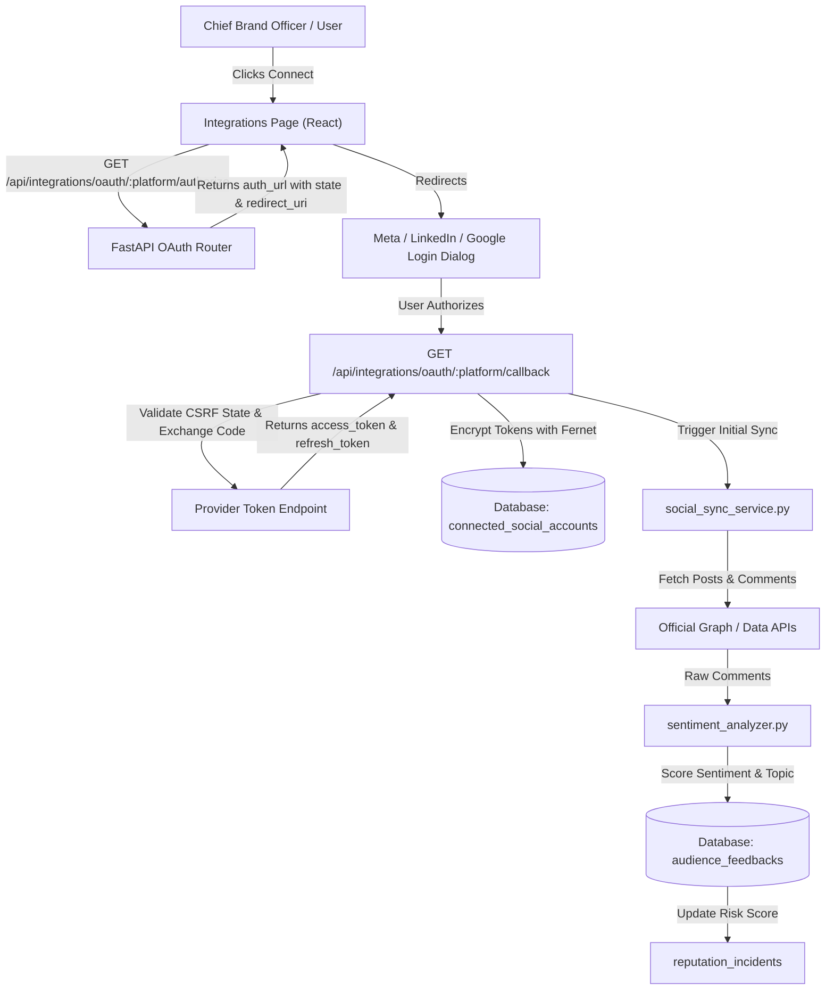

# BrandGuard AI — Social Media OAuth 2.0 & Real API Integrations Report

## 1. Executive Summary & Root Cause Analysis

### Identified Root Causes of the Instagram OAuth Configuration Issue:
1. **Missing Environment Variable Loader (`load_dotenv`)**:
   `backend/core/config.py` was reading environment variables directly via `os.getenv(...)`, but did not invoke `load_dotenv()`. Even if developers created a local `.env` file, FastAPI did not load it into `os.environ` on startup.
2. **Missing Local `.env` Configuration**:
   The project only had an `.env.example` that did not define any social media credentials (`META_APP_ID`, `META_APP_SECRET`, etc.).
3. **Hardcoded Stale Redirect URIs**:
   The default redirect URIs in `config.py` were statically pointing to an old, non-existent Vercel domain (`https://brandguard-ai-web.vercel.app`), causing redirect URI mismatches.
4. **Crude `alert()` Browser Popups**:
   On receiving HTTP 503/400 for unconfigured credentials, `Integrations.tsx` used `window.alert(...)`, disrupting the user experience and freezing button states (`Redirecting...`).
5. **No Granular Integration Status Endpoint**:
   The backend had no health check reporting which providers had valid credentials vs. which were missing keys.

---

## 2. Architecture & Security Upgrades

### A. Secure Token Encryption (AES-GCM / Fernet)
- **Zero Plaintext Stored**: All OAuth `access_token` and `refresh_token` strings are encrypted using Fernet (AES-128 in CBC mode with HMAC-SHA256 authenticated encryption) before persisting to SQLite/PostgreSQL.
- **Key Derivation**: Configured via `TOKEN_ENCRYPTION_KEY`. If unset, securely derives a deterministic 32-byte key from `SECRET_KEY` with SHA-256.
- **Tenant Isolation**: All token queries, refresh operations, and data synchronization calls strictly filter by `organisation_id == current_user.organisation_id`.

### B. In-Page Error Handling (No Alerts)
- Native `window.alert()` and `confirm()` dialogs were completely replaced.
- Unconfigured providers display an in-page **Connection Unavailable** banner, clearly indicating the missing `.env` variable names, exact canonical callback URLs with a **1-click Copy** button, and an active **Test Config** button for instant validation.

---

## 3. Real API Integration Pipeline



---

## 4. Endpoints Implemented

| Method | Endpoint | Description |
| :--- | :--- | :--- |
| `GET` | `/api/integrations/status` | Returns provider configuration, connection status, missing keys, and redirect URIs |
| `POST` | `/api/integrations/oauth/{platform}/test-config` | Tests format and presence of required provider environment variables |
| `GET` | `/api/integrations/oauth/{platform}/authorize` | Generates official authorization URL with CSRF state parameter |
| `GET` | `/api/integrations/oauth/{platform}/callback` | Handles authorization code exchange, token encryption, and initial sync |
| `POST` | `/api/integrations/oauth/{platform}/disconnect` | Revokes server access and purges encrypted tokens from database |
| `POST` | `/api/integrations/oauth/{platform}/sync` | Triggers real-time post and comment ingestion from official APIs |
| `GET` | `/api/webhooks/meta` | Meta Webhook hub challenge verification |
| `POST` | `/api/webhooks/meta` | Receives live comment webhook events with `X-Hub-Signature-256` verification |
| `POST` | `/api/webhooks/youtube` | Receives YouTube PubSub notifications |

---

## 5. Canonical OAuth Redirect URIs & Setup Guide

### Localhost Development:
- **Instagram**: `http://localhost:3000/api/integrations/oauth/instagram/callback`
- **Facebook**: `http://localhost:3000/api/integrations/oauth/facebook/callback`
- **LinkedIn**: `http://localhost:3000/api/integrations/oauth/linkedin/callback`
- **YouTube**: `http://localhost:3000/api/integrations/oauth/youtube/callback`

### Vercel Production (`https://brandguid-ai-two.vercel.app`):
- **Instagram**: `https://brandguid-ai-two.vercel.app/api/integrations/oauth/instagram/callback`
- **Facebook**: `https://brandguid-ai-two.vercel.app/api/integrations/oauth/facebook/callback`
- **LinkedIn**: `https://brandguid-ai-two.vercel.app/api/integrations/oauth/linkedin/callback`
- **YouTube**: `https://brandguid-ai-two.vercel.app/api/integrations/oauth/youtube/callback`

---

## 6. Required Environment Variables

```bash
# Security & Token Storage
TOKEN_ENCRYPTION_KEY=J9QNpPShW3rOz3uXQ5-j7CoFpBKQ-Kp2CSPSOnjOU8w=
FRONTEND_URL=http://localhost:3000
BACKEND_URL=http://127.0.0.1:8000

# Meta / Instagram / Facebook
META_APP_ID=
META_APP_SECRET=
INSTAGRAM_AUTH_MODE=instagram_login
META_REDIRECT_URI=http://localhost:3000/api/integrations/oauth/instagram/callback
FACEBOOK_REDIRECT_URI=http://localhost:3000/api/integrations/oauth/facebook/callback
META_WEBHOOK_VERIFY_TOKEN=brandguard_webhook_2026

# LinkedIn
LINKEDIN_CLIENT_ID=
LINKEDIN_CLIENT_SECRET=
LINKEDIN_REDIRECT_URI=http://localhost:3000/api/integrations/oauth/linkedin/callback

# Google / YouTube Data API v3
GOOGLE_CLIENT_ID=
GOOGLE_CLIENT_SECRET=
GOOGLE_REDIRECT_URI=http://localhost:3000/api/integrations/oauth/youtube/callback
```

---

## 7. Files Changed / Created

1. [backend/core/config.py](file:///c:/Users/hp/Downloads/BRANDGUID%20AI/backend/core/config.py): Added `load_dotenv()`, dynamic redirect URI generators, and platform configuration checkers.
2. [backend/core/security_tokens.py](file:///c:/Users/hp/Downloads/BRANDGUID%20AI/backend/core/security_tokens.py): AES Fernet encryption and decryption engine.
3. [backend/models/all_models.py](file:///c:/Users/hp/Downloads/BRANDGUID%20AI/backend/models/all_models.py): Added `refresh_token` column and `Text` fields to `ConnectedSocialAccount`.
4. [backend/services/social_sync_service.py](file:///c:/Users/hp/Downloads/BRANDGUID%20AI/backend/services/social_sync_service.py): Real API clients for Instagram Graph API, Facebook Graph API, LinkedIn Community API, and YouTube Data API v3.
5. [backend/routers/integrations.py](file:///c:/Users/hp/Downloads/BRANDGUID%20AI/backend/routers/integrations.py): Upgraded status health check, configuration tests, authorization, and code exchange routes.
6. [frontend/src/pages/Integrations.tsx](file:///c:/Users/hp/Downloads/BRANDGUID%20AI/frontend/src/pages/Integrations.tsx): Completely redesigned UI with in-page error cards, test configuration actions, 1-click callback URI copying, and modal disconnect confirmations.
7. [.env.example](file:///c:/Users/hp/Downloads/BRANDGUID%20AI/.env.example): Comprehensive reference template with all social variables.
8. [.env](file:///c:/Users/hp/Downloads/BRANDGUID%20AI/.env): Local configuration with generated encryption keys.
